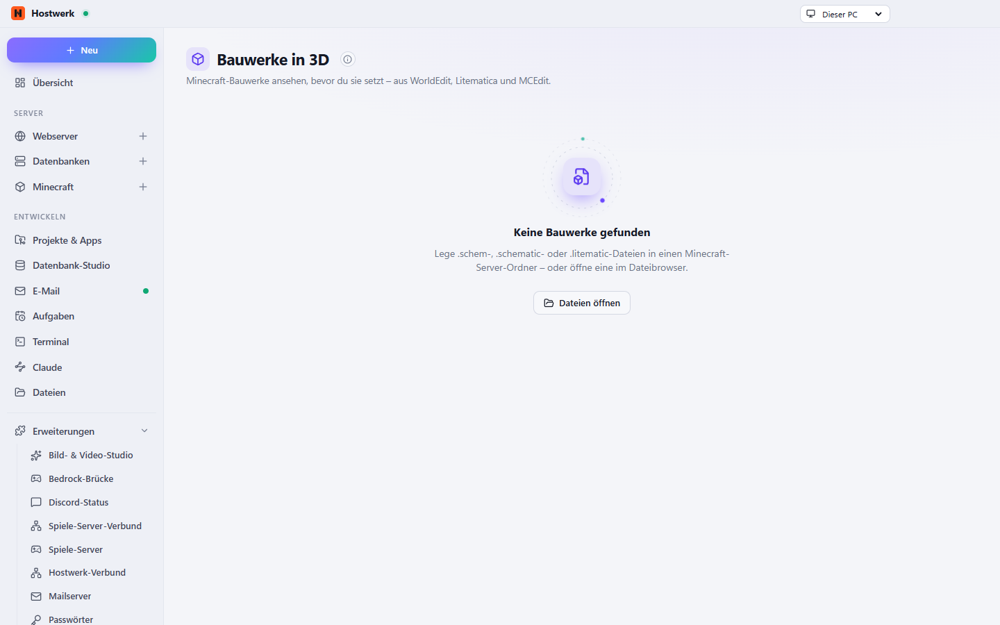

# Bauwerke in 3D

Minecraft-Bauwerke in 3D ansehen, bevor du sie setzt: .schem (WorldEdit/Sponge), .litematic (Litematica) und .schematic (MCEdit).

[English](README.md) · Offizielle [Hostwerk](https://github.com/Passimoritz/hostwerk-public)-Erweiterung (SDK 2.7, native Erweiterung; Datei-Browser-Anschlüsse SDK 3.2)



## Was sie kann

- **Wo:** Dateien (Rechtsklick „In 3D ansehen“ und Vorschau) – seit 1.2.1 ohne eigenen Seitenleisten-Eintrag; die ganze Seite bleibt unter Erweiterungen → Öffnen
- **Im Datei-Browser zu Hause:** Bauwerk-Dateien öffnen sich in der Vorschau direkt in 3D, Rechtsklick „In 3D ansehen“ (SDK 3.2: `files.actions`)
- 3D-Ansicht – drehen, zoomen, hineinschauen; auch per Tastatur (Pfeile drehen, + / − zoomt, Bild auf/ab wechselt die Ebene, 0 setzt zurück)
- Optional eine eigene Seite mit allen Bauwerken deiner Server (in der Seitenleiste unter Dateien, ausblendbar) – der frühere Reiter im Minecraft-Bereich entfällt
- Formate: .schem (WorldEdit/Sponge), .litematic, .schematic (MCEdit) und Vanilla-.nbt-Strukturen
- Ebenen-Schieber – Schicht für Schicht von unten, oder **nur eine Ebene** als Schnitt
- Materialliste mit Anzahl und 64er-Stapeln (auch verdeckte Blöcke), als Text kopieren oder **als CSV** speichern
- **Vergleich zweier Stände:** ein anderes Bauwerk im selben Ordner wählen – welche Blöcke mehr oder weniger geworden sind
- Große Bauwerke: eine Zeichnung je Durchsichtigkeit (Instancing), verdeckte Blöcke werden gar nicht erst gezeichnet
- Ins Spiel setzen kann die Erweiterung bewusst nicht – das bleibt bei WorldEdit/Litematica im Spiel, wo du siehst, was passiert
- Ansicht als PNG-Bild speichern
- Direkt in der Dateivorschau von Hostwerks Dateibrowser
- Läuft auf diesem PC – nichts wird hochgeladen

## Installieren

In Hostwerk unter **Erweiterungen → Entdecken** auf „Installieren“ klicken. Wer die Funktion schon in Hostwerk 2.8 benutzt hat, bekommt die Erweiterung beim Update automatisch – mit allen Daten.

Native Erweiterungen laufen als Teil von Hostwerk (eigener Server- und Oberflächen-Teil). Darum installiert Hostwerk sie nur aus dem offiziellen Katalog (mit Prüfsumme) oder im Entwickler-Modus.

## Daten

Keine eigenen Daten.

## Entwickeln

```bash
node --test tests/*.test.js          # Tests
node build-native.js .               # Oberfläche bauen (sdk/build-native.js aus hostwerk-public)
node check.js . --strict             # Prüfung wie im Katalog (sdk/check.js)
```

Quelltext der Oberfläche in `ui/src`, Server-Teil in `server/`. Texte im Code sind Englisch, Deutsch steht in `locales/de.json`.

## Lizenz

MIT
