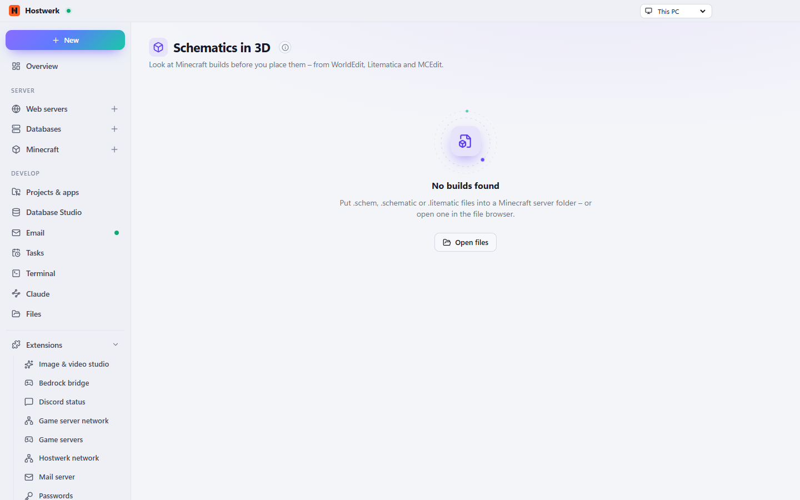

# Schematics in 3D

Look at Minecraft builds in 3D before you place them: .schem (WorldEdit/Sponge), .litematic (Litematica) and .schematic (MCEdit).

[Deutsch](README.de.md) · An official [Hostwerk](https://github.com/Passimoritz/hostwerk-public) extension (SDK 2.7, native extension)



## What it does

- **Where:** Files (right-click “View in 3D” and the preview) – no own sidebar entry since 1.2.1; the full page stays under Extensions → Open
- **At home in the file browser:** build files open in 3D right in the preview, right-click “View in 3D” (SDK 3.2: `files.actions`)
- 3D view – turn, zoom, look inside; also with the keyboard (arrows rotate, + / − zoom, Page up/down change the layer, 0 resets)
- Optionally an own page with every build of your servers (sidebar under Files, can be hidden) – the former tab in the Minecraft area is gone
- Formats: .schem (WorldEdit/Sponge), .litematic, .schematic (MCEdit) and vanilla .nbt structures
- Layer slider – layer by layer from the bottom, or **just one layer** as a slice
- Material list with counts and stacks of 64 (hidden blocks included), copy as text or save **as CSV**
- **Compare two versions:** pick another build in the same folder – which blocks became more or fewer
- Big builds: one draw call per opacity (instancing), hidden blocks are never drawn
- Placing builds into a world is deliberately not part of it – that stays with WorldEdit/Litematica in the game, where you see what happens
- Save the view as a PNG picture
- Right in the file preview of Hostwerk’s file browser
- Runs on this PC – nothing is uploaded

## Install

In Hostwerk: **Extensions → Discover** and click “Install”. If you already used this feature in Hostwerk 2.8, the update installs the extension by itself – with all your data.

Native extensions run as part of Hostwerk (own server and interface part). That is why Hostwerk only installs them from the official catalogue (with checksum) or in developer mode.

## Data

No data of its own.

## Develop

```bash
node --test tests/*.test.js          # tests
node build-native.js .               # build the interface (sdk/build-native.js from hostwerk-public)
node check.js . --strict             # same check as the catalogue (sdk/check.js)
```

Interface source in `ui/src`, server part in `server/`. Texts in the code are English, German is in `locales/de.json`.

## License

MIT
